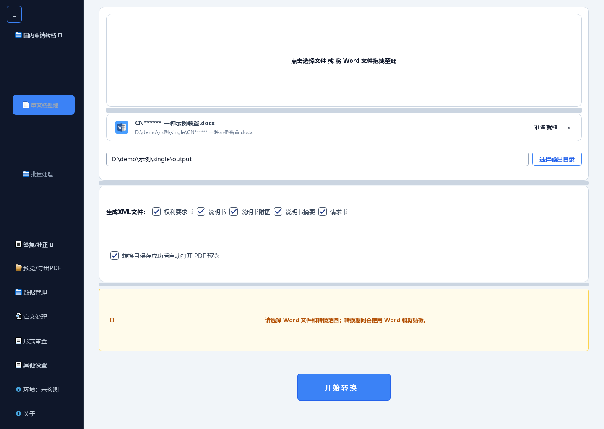
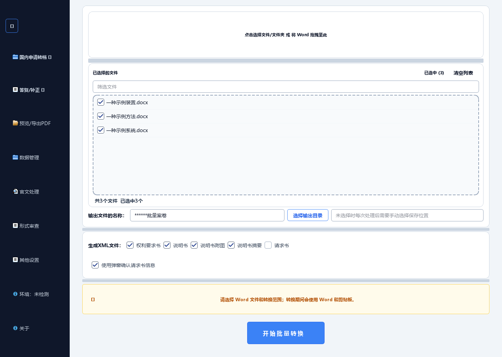
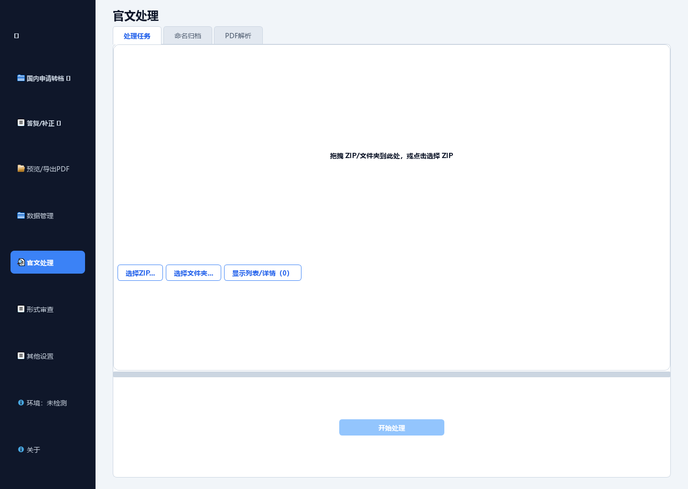
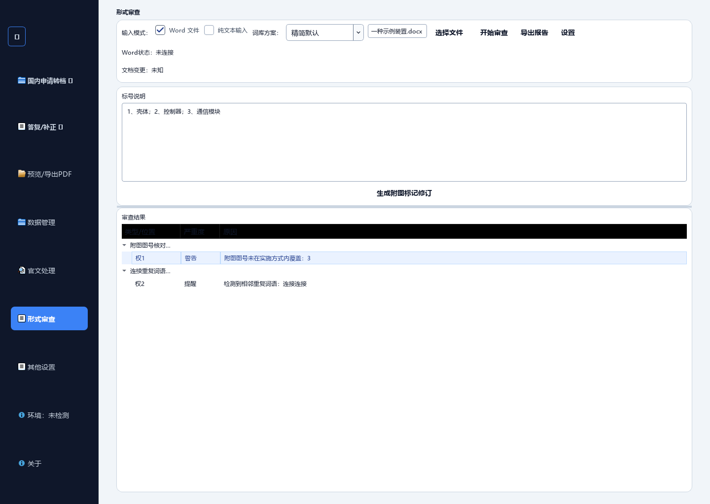
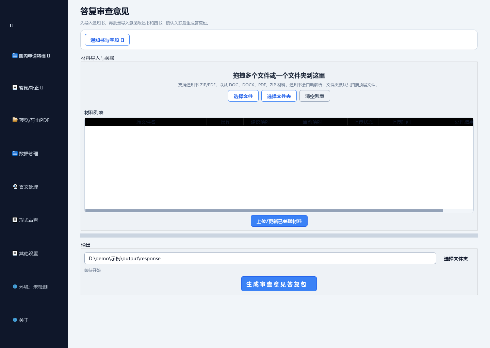
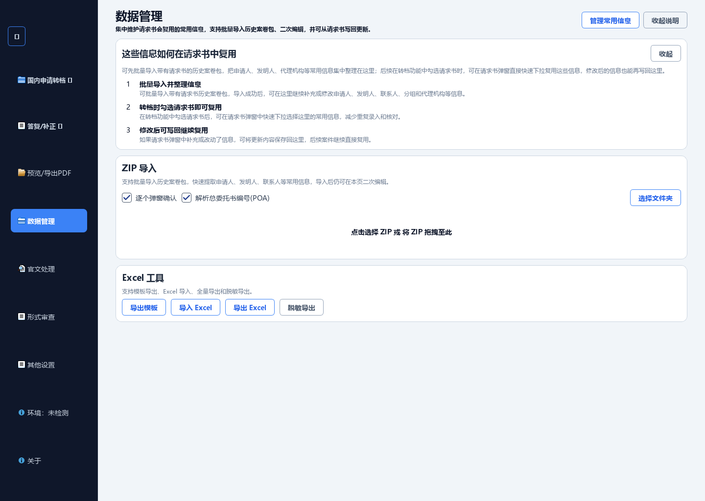
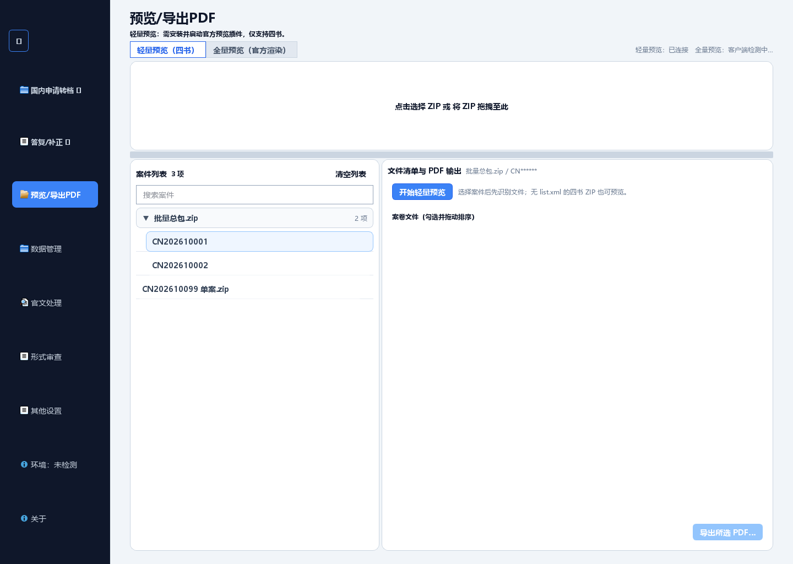

<div align="center">


# 通官文旦-专利工具

**面向中国专利文档处理的 Windows 桌面工具**

Word 转档 CPC XML · 官方通知书整理 · 形式审查 · 答复与补正材料


**免费开源 · 无需激活 · 离线运行 · 数据不出本机**

<h3><a href="https://github.com/MrEgg2021/TongGuanWenDan-PatentTool/releases/latest">⬇️ 下载最新版</a></h3>

<p>不需要注册账号，也不需要会 Git，下载后双击即可运行</p>

</div>

---

## ✨ 功能一览

| 模块 | 能力 |
| --- | --- |
| **国内申请转档** | Word（.doc/.docx）转 CPC XML 与案卷 ZIP，支持单文档与批量处理；请求书信息确认、页眉预检、四书（权利要求书 / 说明书 / 附图 / 摘要）章节识别 |
| **官文处理** | 官方通知书 ZIP 批量解析、PDF 合并与拆分、自定义命名、长期归档与 Excel 处理记录 |
| **形式审查** | 按内置规则库审查四书（占位残留、编号、附图标记等），结果树定位、误查忽略、批注写回与附图标记修订 |
| **答复与补正** | 审查意见答复、补正、主动答复 / 主动补正四类材料生成，通知书解析与案件信息联动 |
| **数据管理** | 常用信息（申请人 / 发明人 / 代理机构）库管理，请求书联动预填，历史案卷 ZIP 批量导入与 Excel 导入导出 |
| **PDF 预览** | 对接官方预览服务，轻量 / 全量两种模式，预览合并与另存 PDF |
| **环境检测** | Word 环境检测、预览服务检测；运行日志保存在本机，供自行排查 |

## 📸 界面预览

| | |
| :---: | :---: |
| **单文档转档** | **批量处理** |
|  |  |
| **官文处理** | **形式审查** |
|  |  |
| **答复审查意见** | **常用信息管理** |
|  |  |
| **PDF 预览导出** | |
|  | |

> 界面截图由项目自带的截图工具以合成示例数据自动生成，不含任何真实客户信息。

## 下载与安装

不需要注册账号，也不需要会 Git。按下面四步操作即可。

<!-- 下载页需先发布 GitHub Release 后才可正常访问 -->

### 第 1 步：打开下载页

进入项目的 GitHub Releases 页面（最新版本）：

https://github.com/MrEgg2021/TongGuanWenDan-PatentTool/releases/latest

### 第 2 步：下载 EXE 文件

滚动到页面下方的 **Assets** 区域，下载 `TongGuanWenDan-PatentTool_v1.0.0.exe`（因 GitHub 附件名不支持中文，所以用英文文件名；运行后程序窗口标题仍为“通官文旦-专利工具”）。

- 只下载 `.exe` 文件。
- 不要点 `Source code (zip)` / `Source code (tar.gz)`，那是源码，双击不能运行。
- 页面显示的版本号会随发行变化，以实际文件名为准。

### 第 3 步：双击运行

- **免安装**：适用于 Windows 10/11，不需要配置 Python，也不需要管理员权限，可以放在任意文件夹；建议单独建一个目录存放，便于以后替换新版。
- Word 转档功能要求本机安装 Microsoft Word。
- 官文 PDF 预览需要本机已安装专利业务办理系统客户端，详见 [预览环境](docs/CNIPA_PREVIEW_RUNTIME.md)。

### 第 4 步：首次运行可能遇到的提示

| 现象 | 处理方式 |
| --- | --- |
| Windows 提示“Windows 已保护你的电脑” | 点“更多信息”，再点“仍要运行”。未购买代码签名的程序通常会有此提示 |
| 杀毒软件报告可疑或直接隔离 | 加入信任/白名单后重新下载运行；本程序不联网、不上传任何文件 |
| 双击没反应、打开后立即退出 | 确认窗口标题或关于页显示的版本，再查看程序目录下的 `conversion.log` 了解详情 |

### 无法访问 GitHub 怎么办

源码在 GitHub 与 [Gitee 国内镜像](https://gitee.com/mregg2021/TongGuanWenDan-PatentTool) 保持同步，浏览和克隆源码用哪个都行。但受 Gitee 单文件大小限制，**免安装、双击即用的便携版 EXE 只在 GitHub Releases 发布，Gitee 上没有**。如果你在国内、访问 GitHub 不便：

- **国内直连（推荐）**：打开[飞书使用手册](https://tcnss0u1hgy9.feishu.cn/docx/O5f5d9AWHop5OjxkhakcP3Jkntb)，下载文档内附件 `通官文旦-专利工具_v1.0.0.exe`，无需登录；
- 或换网络环境后从 [GitHub Releases](https://github.com/MrEgg2021/TongGuanWenDan-PatentTool/releases/latest) 下载（版本以 Release 为准，飞书附件为手工上传副本，可能略有滞后）；
- 仍无法获取时，添加作者微信 `MrEgg208` 说明情况，获取便携版 EXE 文件。

### 如何更新

本程序是离线便携版，**没有自动更新**。需要新版时重新下载新的 `.exe` 替换旧文件即可；用户偏好与业务数据库保存在本机用户目录，替换程序文件不会影响其中的数据。

## 从源码运行

```powershell
python -m venv .venv
.venv\Scripts\python -m pip install -r requirements.txt -r requirements-dev.txt
.venv\Scripts\python gui_app.py
```

使用说明详见 [用户手册](docs/USER_GUIDE.md)，版本变化见 [更新日志](用户使用手册+更新日志/更新日志/v1.0.0.md)。

## ⌨️ 命令行

```powershell
# 在当前目录查找 DOC/DOCX 并转换为 CPC XML
python tools/cli_main.py

# 导出发明专利 Word 模板
python tools/cli_main.py --export-template
```

## 🔒 数据与隐私

- **完全离线**：所有处理在本机完成，不联网上传任何文档或数据；运行日志只写入本机 `conversion.log`。
- **用户数据自主**：普通偏好保存在本地 `user_prefs.json`，业务数据库路径由你在数据管理页自行设置；支持备份与脱敏导出。
- **进程保护**：Office 进程保护只管理本工具自己启动的 Word 进程，判定失败时宁可不动也不会误杀你的其他程序。

## 🧭 项目结构

<details>
<summary>展开查看</summary>

| 路径 | 职责 |
| --- | --- |
| `gui_app.py`、`gui/` | 桌面入口、页面、任务分发与交互 |
| `tools/cli_main.py`、`tools/` | CLI、质量检查、构建和发布工具 |
| `core/` | 文档解析、转换、偏好与业务规则；不依赖 GUI |
| `core/official_docs/` | 官方通知书解析、合并、命名、归档与记录 |
| `resources/` | 配置、模板、界面素材与第三方许可 |
| `tests/` | 单元测试与回归检查（1500+ 用例） |
| `docs/` | 用户手册、开发说明及维护流程 |

结构与转换规则见 [规则总览](docs/RULES_OVERVIEW.md)，维护边界见 [项目维护说明](docs/PROJECT_MAINTENANCE.md)。

</details>

## 🔧 开发与验证

```powershell
python -m compileall -q core gui tools tests gui_app.py
python -m ruff check .
python tools/quality/pyflakes_gate.py gui_app.py core gui tools tests
python -m unittest discover -s tests -p "test_*.py"
python tools/check_text_encoding_integrity.py
```

构建发行 EXE 使用 `python tools/build_release_exes.py`：先由 `tools/build_nuitka_pyd.py` 把核心模块编译为 `.pyd`，再按 `CPCXMLGui.spec` 打包，默认禁用 UPX。构建依赖、验证和发布要求见 [开发与发布](docs/GIT_WORKFLOW.md)。

实际 Office、官方运行库和真实业务样例测试依赖本机环境，跳过原因以测试输出为准；真实客户文件不随源码提供。

## 📄 开源许可

- 项目自有代码采用 **AGPL-3.0-only**：使用、修改和再分发须遵守该许可；发布程序时应提供该版本的完整对应源码及必要构建脚本。
- **使用不产生开源义务**：日常使用、机构内部多台电脑部署，或在内部工作流中调用，都不需要公开你的文档、案件或内部代码。程序离线运行，不上传文档、不联网、不含遥测。
- 只有修改本程序并对外分发，或改造后作为对外网络服务提供时，才需要按 AGPL 提供对应源码；源码获取方式见[第三方声明](THIRD_PARTY_NOTICES.md#对应源码获取)。
- 第三方组件保留各自许可，见 [第三方声明](THIRD_PARTY_NOTICES.md) 与 [中文许可说明](resources/OPEN_SOURCE_LICENSE.zh-CN.md)。
- 提交贡献即表示有权提交相关内容，并同意按 AGPL-3.0-only 提供。不要提交客户文档、凭证、私钥或未获授权的素材。
- 项目名称、图标与发行标识仅用于标识官方发行版本：基于本项目修改后的版本可以自由分发，但请改用你自己的名称与图标，以免使用者误认为官方版本。

## 📮 问题反馈

遇到问题时，可以按下面几步先自行排查：

1. 查阅 [用户手册](docs/USER_GUIDE.md) 与 [规则总览](docs/RULES_OVERVIEW.md)
2. 打开程序目录下的 `conversion.log`（程序目录不可写时为 `%APPDATA%\CPC-XML-Converter\conversion.log`），按错误码定位
3. 在 [Issues](https://github.com/MrEgg2021/TongGuanWenDan-PatentTool/issues) 中搜索同类问题；需要提问时附上程序版本、操作步骤、错误提示和必要的日志片段

> 为保护未公开的专利信息，请勿上传真实案卷、申请文件或客户资料。

程序按 AGPL-3.0-only 开源：你可以自行修改、构建和使用，也欢迎提交 Pull Request。

作者：**MrEgg2021**

- 邮箱：[1649251313@qq.com](mailto:1649251313@qq.com)
- 微信：`MrEgg208`

<p align="center"></p>

## ⚠️ 使用提醒

本工具辅助生成与整理专利申请文件，但**不替代人工核对**——转换、审查、写回的结果请按官方要求逐项确认后再提交。操作前保存原稿，定期备份数据库。
